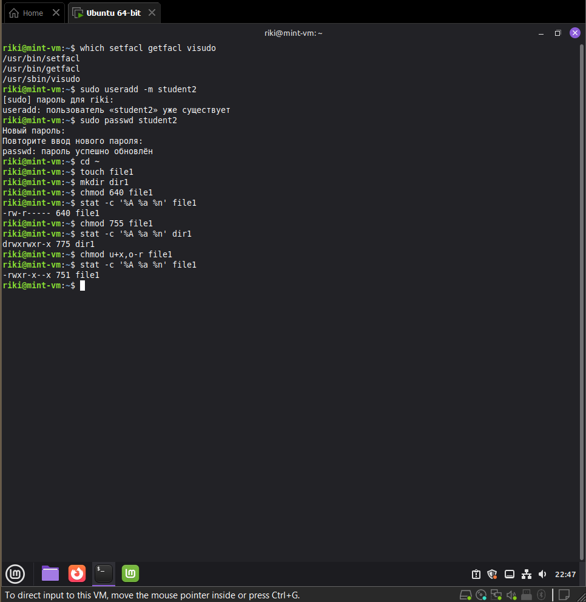

 Задание 1. Чтение и запись прав доступа

1. Эксперимент с chmod

Я создал файл и каталог, затем изменял их права числовыми и буквенными обозначениями, проверяя результат через `stat`:

cd ~
touch file1
mkdir dir1

chmod 640 file1
stat -c '%A %a %n' file1
# Вывод: -rw-r----- 640 file1

chmod 755 file1
stat -c '%A %a %n' file1
# Вывод: -rwxr-xr-x 755 file1

chmod 750 dir1
stat -c '%A %a %n' dir1
# Вывод: drwxr-x--- 750 dir1

chmod u+x,o-r file1
stat -c '%A %a %n' file1
# Вывод: -rwxr-x--x 751 file1

2. Таблица перевода прав
Буквенный формат       Восьмеричный код         Пояснения
rw-r--r--               644                      Владелец: чтение+запись; Группа/Остальные: только чтение

rwxr-x---               750                      Владелец: всё; Группа: чтение+исполнение; Остальные: ничего

rw-------               600                      Только владелец может читать и писать (секретные файлы)

r-xr-xr-x               555                      Все могут читать и исполнять, но никто не может менять 

3. Ответы на контрольные вопросы

В чём разница между правом x на файл и на каталог?

    На файле (file1): бит x разрешает запуск файла как программы или скрипта. Без него система откажет в выполнении, даже если есть права на чтение.
    На каталоге (dir1): бит x разрешает вход в каталог (доступ к его содержимому по полному пути). Без x на каталог вы не сможете открыть файлы внутри него, даже если знаете их имена и имеете права на сами файлы. Право r на каталог позволяет лишь просматривать список файлов (ls), но не открывать их.

Почему chmod -R 777 / сломал бы систему?
Команда chmod -R 777 / рекурсивно даёт всем пользователям полные права (чтение, запись, исполнение) на абсолютно все файлы и каталоги системы. Это катастрофа для безопасности:

  1 Любой пользователь сможет перезаписать системные бинарники (/bin/bash, /usr/bin/sudo), подменив их вредоносным кодом.
   2 Станут доступны для чтения приватные ключи SSH, пароли баз данных, файлы /etc/shadow.
   3 Скрипты и конфигурационные файлы, которые должны быть защищены от записи, станут уязвимы для модификации.
   4 SUID-биты на многих системных утилитах перестанут работать корректно или создадут новые дыры. 
   
   Восстановить систему после такой команды крайне сложно, часто требуется полная переустановка.
