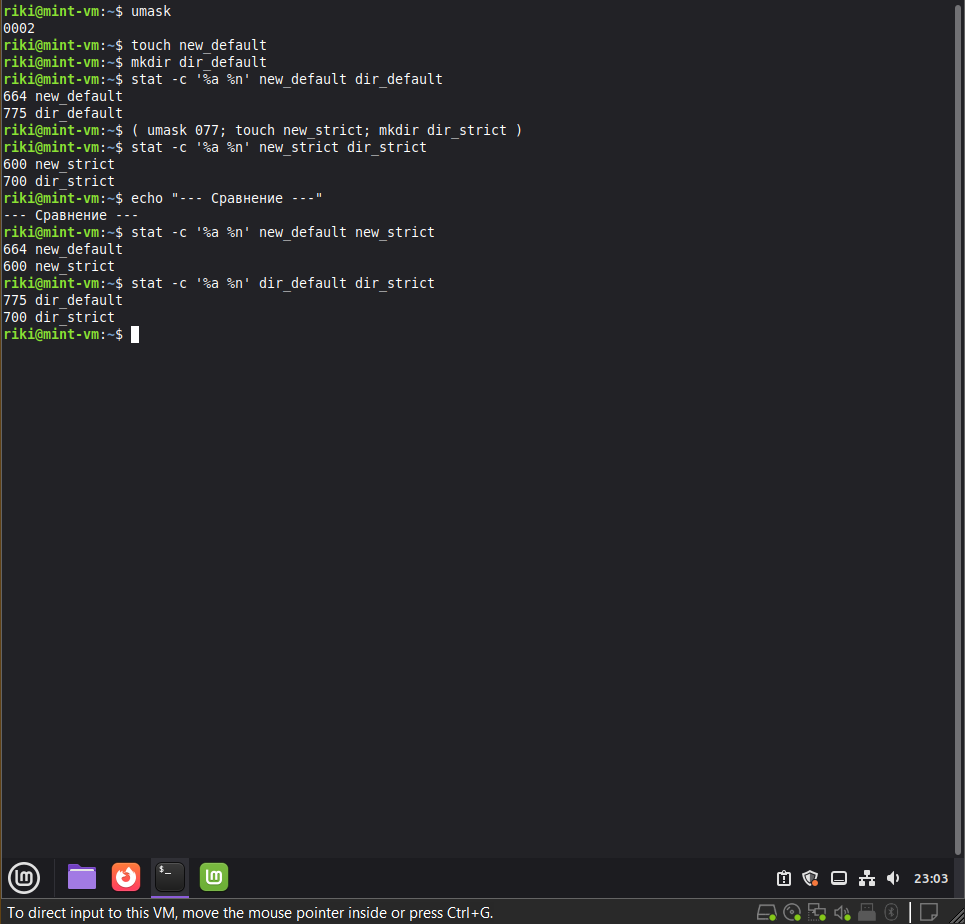

Задание 2. Маска прав доступа (umask)

 1. Эксперимент с масками

Я проверил, как текущая маска (`0022`) и строгая маска (`0077`) влияют на права новых файлов и каталогов:

umask # 0002

touch new_default
mkdir dir_default
stat -c '%a %n' new_default dir_default
# Вывод:
# 664 new_default
# 775 dir_default

( umask 077; touch new_strict; mkdir dir_strict )
stat -c '%a %n' new_strict dir_strict
# Вывод:
# 600 new_strict
# 700 dir_strict

2. Математика прав

Права новых объектов рассчитываются как разность между базовыми правами и маской:

Объект            Базовые права      Маска            Итоговые права       Пояснение

Файл (default)    666 (rw-rw-rw-)  022 (--w--w-)      664 (rw-rw-r--)       Убраны права на запись для группы и остальных

Каталог(default)  777 (rwxrwxrwx)  022 (--w--w-)      775 (rwxrwxr-x)       Убраны права на запись для группы и остальных

Файл (strict)     666 (rw-rw-rw-)  077 (-wx-wx-wx)    600 (rw-------)       Убраны все права для группы и остальных

Каталог (strict)  777 (rwxrwxrwx)  077 (-wx-wx-wx)    700 (rwx------)       Убраны все права для группы и остальных

3. Ответы на контрольные вопросы

Почему у файлов нет бита x по умолчанию, а у каталогов есть?
Базовые права для файлов при создании равны 666, так как ядро не может знать, является ли новый файл исполняемым скриптом или просто текстом/данными. Давать бит исполнения всем новым файлам опасно.
Для каталогов базовые права 777, потому что без бита x (execute/search) каталог невозможно использовать: нельзя войти в него, открыть файлы внутри или создать новые. Каталог без x бесполезен.

Зачем на сервере с конфиденциальными данными ставят umask 077?
Маска 077 гарантирует, что любые новые файлы и каталоги будут доступны только владельцу. Это критически важно на многопользовательских серверах, где хранятся приватные ключи, пароли, базы данных или персональные данные. Даже если администратор забудет явно выставить права chmod 600, маска 077 страхует от случайной утечки информации другим пользователям системы.
