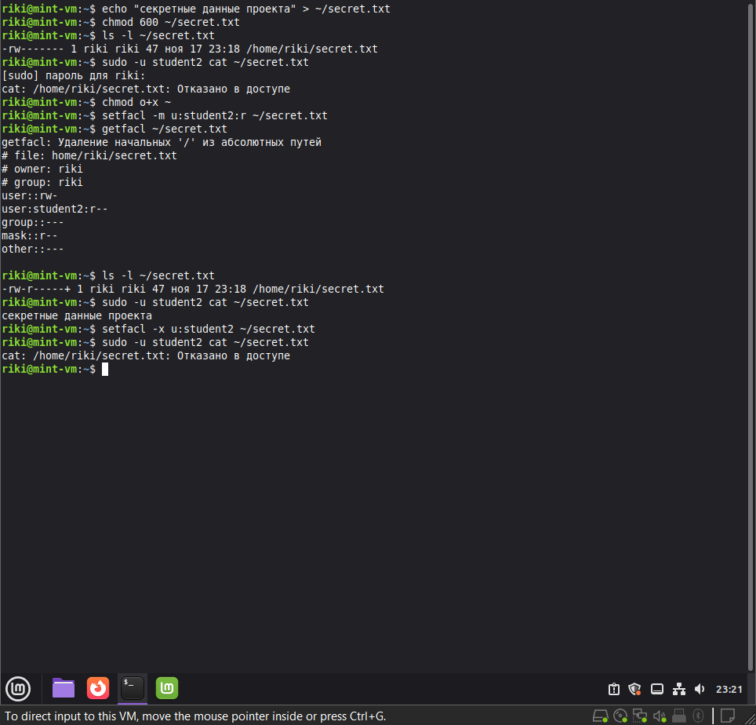

 Задание 3. Разграничение доступа и ACL

 1. Эксперимент с ACL

Я создал приватный файл, закрытый от всех, кроме владельца, и попытался дать доступ к нему второму пользователю (`student2`) без изменения владельца и базовых прав.

echo "секретные данные проекта" > ~/secret.txt
chmod 600 ~/secret.txt
sudo -u student2 cat ~/secret.txt
# Вывод: cat: /home/riki/secret.txt: Отказано в доступе

Затем я добавил ACL и проверил результат:
chmod o+x ~ # Разрешаем вход в домашний каталог (иначе ACL на файл бесполезен)
setfacl -m u:student2:r ~/secret.txt
getfacl ~/secret.txt
ls -l ~/secret.txt

Вывод getfacl:
# file: home/riki/secret.txt
# owner: riki
# group: riki
user::rw-
user:student2:r--
group::---
mask::r--
other::---

Вывод ls -l:
-rw-r-----+ 1 riki riki 47 ноя 17 23:18 /home/riki/secret.txt

Проверка доступа:
sudo -u student2 cat ~/secret.txt
# Вывод: секретные данные проекта

После удаления правила ACL доступ снова был закрыт:
setfacl -x u:student2 ~/secret.txt
sudo -u student2 cat ~/secret.txt
# Вывод: cat: /home/riki/secret.txt: Отказано в доступе

2. Ответы на контрольные вопросы

Чем ACL удобнее, чем добавление student2 в группу-владельца?
Стандартные права Linux имеют только три категории: владелец, группа, остальные. Если нужно дать доступ конкретному пользователю (или нескольким разным пользователям с разными правами), создание отдельных групп становится громоздким («групповой хаос»). ACL позволяет точечно назначать права любому UID/GID без изменения структуры групп системы. Также ACL поддерживает маску (mask), которая ограничивает максимальные права для всех записей ACL (кроме владельца и other), что даёт гибкий контроль.

Почему понадобилось chmod o+x ~ ?
Для доступа к файлу /home/riki/secret.txt пользователь student2 должен не только иметь право читать сам файл, но и иметь право проходить (execute/search) через все родительские каталоги на пути к нему. Домашний каталог /home/riki по умолчанию часто имеет права 750 или 700, запрещая вход другим пользователям. Без бита x на каталоге ядро просто не позволит процессу student2 «увидеть» содержимое папки, даже если ACL на файле разрешает чтение.
