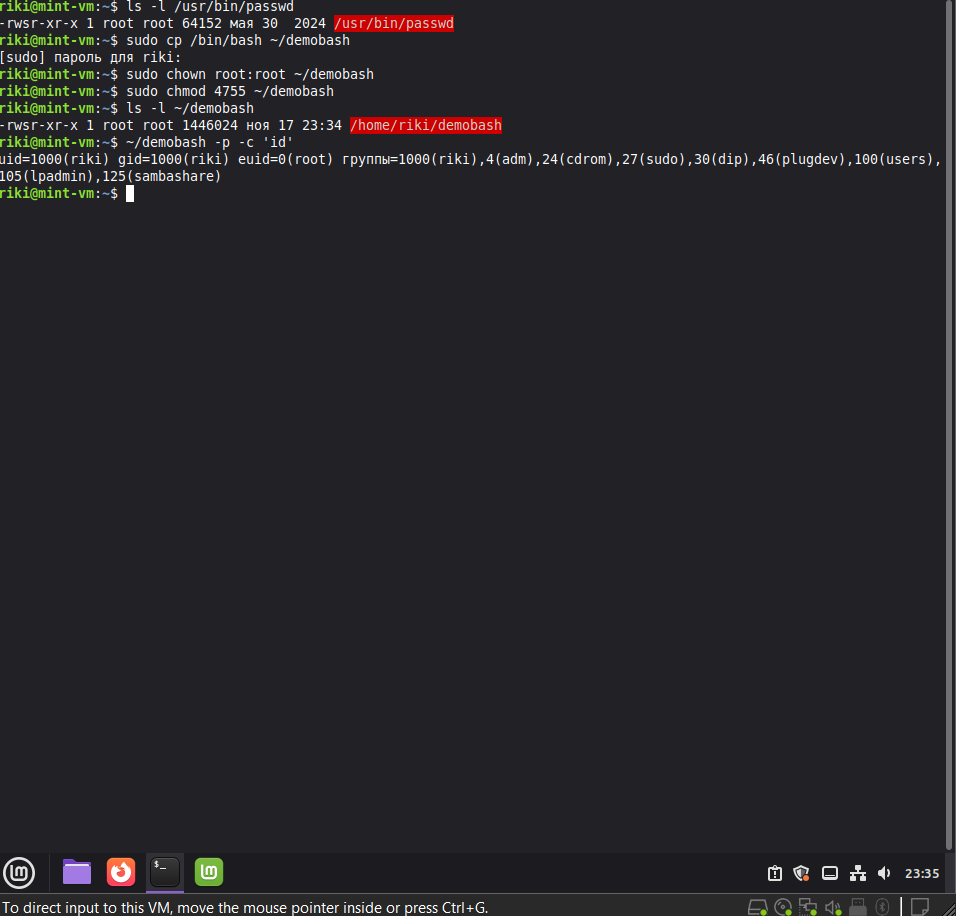

 Задание 4. Как работает SUID

1. Анализ штатного SUID-файла

Я посмотрел на системную утилиту passwd, которая является классическим примером безопасного использования SUID:

ls -l /usr/bin/passwd

Вывод:
-rwsr-xr-x 1 root root 64152 мар 30  2024 /usr/bin/passwd
Буква s на месте бита исполнения владельца указывает на установленный SUID-бит. Владелец файла — root.

2. Создание демонстрационной программы

Я скопировал интерпретатор bash, сделал его владельцем root и установил SUID-бит:
sudo cp /bin/bash ~/demobash
sudo chown root:root ~/demobash
sudo chmod 4755 ~/demobash
ls -l ~/demobash

Вывод:
-rwsr-xr-x 1 root root 1446024 ноя 17 23:34 /home/riki/demobash
Права -rwsr-xr-x подтверждают, что бит SUID установлен.

3. Проверка повышения привилегий

Я запустил demobash с ключом -p (preserve privileges) и выполнил команду id:
~/demobash -p -c 'id'

Вывод:
uid=1000(riki) gid=1000(riki) euid=0(root) группы=1000(riki),.

4. Ответы на контрольные вопросы

Что означает euid=0 и почему он появился?

    uid=1000(riki) — это мой реальный идентификатор пользователя. Система знает, кто именно запустил процесс.
    euid=0(root) — это эффективный идентификатор. Ядро использует его для проверки прав доступа к файлам, сокетам и другим ресурсам.
    Он появился равным 0, потому что у исполняемого файла demobash установлен SUID-бит, а владелец файла — root (UID 0). При запуске такой программы ядро временно подменяет эффективный UID процесса на UID владельца файла.

Почему passwd может записать в /etc/shadow, хотя я сам — нет?
Файл /etc/shadow, хранящий хэши паролей, имеет права -rw------- root shadow. Обычный пользователь riki не входит в группу shadow и не является владельцем, поэтому напрямую прочитать или изменить этот файл он не может.
Однако утилита /usr/bin/passwd имеет SUID-бит и принадлежит root. Когда я запускаю passwd, она временно получает права root (euid=0). Под этими привилегиями она может открыть /etc/shadow, найти запись моего пользователя, обновить хэш пароля и сохранить файл. После завершения работы программы привилегии сбрасываются. Это позволяет безопасно менять пароль без выдачи пользователю постоянного доступа root.

