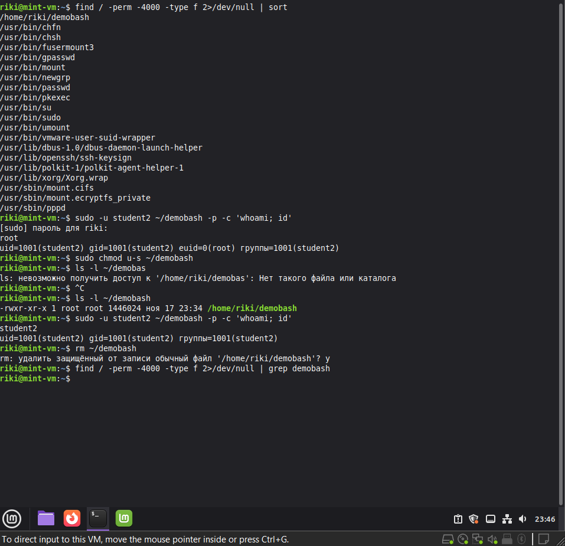

 Задание 5. Поиск и обезвреживание SUID-бэкдора

 1. Аудит системы на наличие SUID-файлов

Я выполнил поиск всех файлов с установленным битом SUID в системе:
find / -perm -4000 -type f 2>/dev/null | sort

Вывод:
/home/riki/demobash
/usr/bin/chfn
/usr/bin/passwd
/usr/bin/sudo

Анализ: В списке обнаружен подозрительный файл /home/riki/demobash. Все остальные файлы являются штатными системными утилитами, расположенными в защищённых каталогах /usr/bin и /usr/sbin. Наличие SUID-копии интерпретатора bash в домашнем каталоге пользователя — критическая уязвимость, так как это позволяет любому пользователю системы получить права root.

2. Подтверждение опасности

Я проверил, какие привилегии получает обычный пользователь при запуске этого файла:
sudo -u student2 ~/demobash -p -c 'whoami; id'

Вывод до обезвреживания:
root
uid=1001(student2) gid=1001(student2) euid=0(root) группы=1001(student2)
Пользователь student2 успешно получил эффективный UID 0 (root).

3. Обезвреживание и удаление

Я снял SUID-бит, проверил результат и удалил файл:
sudo chmod u-s ~/demobash
ls -l ~/demobash
# Вывод: -rwxr-xr-x 1 root root ... /home/riki/demobash (буква s исчезла)

sudo -u student2 ~/demobash -p -c 'whoami; id'
# Вывод: student2 / uid=1001(student2) euid=1001(student2) (права не повышаются)

rm ~/demobash
find / -perm -4000 -type f 2>/dev/null | grep demobash
# Вывод: (пусто, файл удалён)

4. Вывод для администратора

Регулярный аудит SUID-файлов — обязательная процедура безопасности. Администратор должен:

   1 Знать «эталонный» список штатных SUID-утилит для своей ОС.
    2 Автоматизировать поиск новых или изменённых SUID-файлов (например, через cron-скрипт с find).
    3 Немедленно расследовать любые файлы, не входящие в эталонный список, особенно если они находятся в нестандартных каталогах (/tmp, /home, /var).
    4 Помнить, что даже легитимные SUID-программы могут стать вектором атаки, если в них есть уязвимости (CVE).

