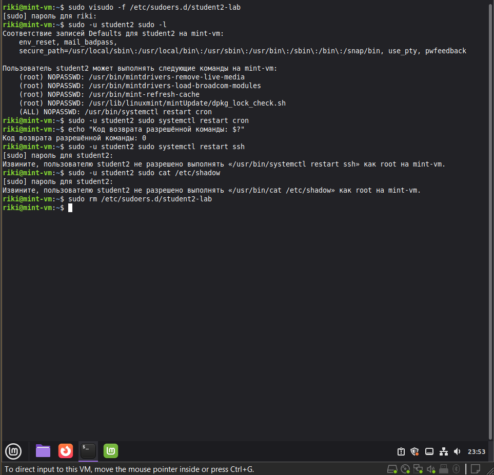

 Задание 6. Ограниченное правило sudo

 1. Настройка правила

Я создал отдельный файл правил для пользователя `student2`, разрешив ему выполнять только перезапуск службы `cron` без ввода пароля:

sudo visudo -f /etc/sudoers.d/student2-lab
# Содержимое файла:
# student2 ALL=(ALL) NOPASSWD: /usr/bin/systemctl restart cron

Использование visudo критически важно: эта утилита проверяет синтаксис перед сохранением. Если я допущу ошибку в файле sudoers, система может заблокировать возможность получения прав root для всех пользователей, включая администратора. Прямое редактирование через nano или vim лишено этой защиты.

2. Проверка границ доступа

Я проверил, какие команды доступны student2:
sudo -u student2 sudo -l

Вывод:
Пользователь student2 может выполнять следующие команды на mint-vm:
    ...
    (ALL) NOPASSWD: /usr/bin/systemctl restart cron

  Затем я протестировал разрешённую и запрещённые команды:
  sudo -u student2 sudo systemctl restart cron
echo "Код возврата: $?" # 0

sudo -u student2 sudo systemctl restart ssh
# Извините, пользователю student2 не разрешено выполнять «/usr/bin/systemctl restart ssh» как root на mint-vm.

sudo -u student2 sudo cat /etc/shadow
# Извините, пользователю student2 не разрешено выполнять «/usr/bin/cat /etc/shadow» как root на mint-vm.

3. Ответы на контрольные вопросы

Чем sudo лучше прямого входа под root?

1 Аудит: Каждая команда, выполненная через sudo, записывается в журнал (/var/log/auth.log) с указанием имени реального пользователя. При работе под root невозможно узнать, кто именно выполнял действия.
2 Принцип наименьших привилегий: Пользователь получает права root только на время выполнения конкретной команды, а не на всю сессию.
3 Безопасность: Нет риска случайно выполнить опасную команду (например, rm -rf /) в сессии root, так как по умолчанию пользователь работает с обычными правами.

Почему давать sudo на vim, less или find опасно?
Эти программы имеют встроенные возможности запуска оболочки или чтения произвольных файлов. В базе GTFOBins описаны способы их эксплуатации:

    sudo vim: внутри можно выполнить :!bash и получить полноценную root-оболочку.
    sudo less: аналогично, через !/bin/bash.
    sudo find: через -exec /bin/bash \;.
    Выдача прав на такие программы фактически равносильна выдаче полного доступа root, так как ограничение на одну команду обходится за секунды. Безопаснее использовать специализированные утилиты (например, view вместо vim для просмотра) или настраивать ограничения через sudoers с ключевыми словами NOEXEC.
